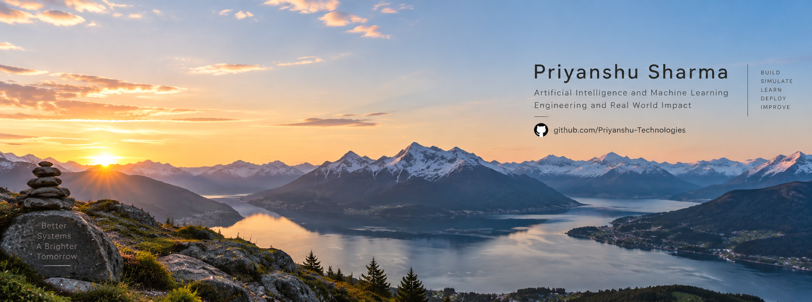

 

<h1 align="center">Hey, welcome to my side of GitHub — I'm Priyanshu Sharma 👋</h1>

  <strong>Artificial Intelligence & Machine Learning · Software Engineering</strong>

  I develop AI/ML and engineering solutions across computer vision, predictive modeling, systems, and scientific computing.

---

## 👋 About Me

I'm Priyanshu Sharma, an AI/ML and engineering-focused developer interested in building practical software systems for real-world problems.

My work sits at the intersection of **artificial intelligence, machine learning, software engineering, and computational methods**. I enjoy working across the full process — understanding a problem, developing a technical approach, implementing it, evaluating the results, and turning it into a usable system.

I'm particularly interested in **machine learning, deep learning, computer vision, intelligent systems, scientific computing, simulation, and engineering applications of AI**.

---

## 🛠️ Technologies I've Worked With

### 🤖 AI / Machine Learning

  

### 👁️ Computer Vision & Deep Learning

### 📊 Data & Scientific Computing

### ⚙️ Engineering & Deployment

## 🚀 Featured Projects

<table>
<tr>
<td width="33%" valign="top">

### NORAG

**Next-generation Orchestrated Retrieval-Augmented Generation — a modular, self-hostable RAG engine built from scratch.**

A RAG system that checks its own answers against your documents, entirely offline. All of it runs on your laptop: no API keys, no cloud, no data leaving your machine.

**Built with**

`Python` `FastAPI` `FastEmbed` `Ollama` `SQLite` `React 19` `TypeScript` `Vite` `pytest`

[View Repository →](https://github.com/Priyanshu-Technologies/NORAG)

</td>

<td width="33%" valign="top">

### CrackVision

**AI-Powered Surface Defect Detection**

Detects and segments potential surface defects using a trained YOLO11 model, with visual prediction overlays and a deployable Streamlit application.

**Built with**

`Python` `YOLO11` `OpenCV` `Ultralytics` `Pytorch` `NumPy` `Streamlit` `Docker` 

[View Repository →](https://github.com/Priyanshu-Technologies/CrackVision)

</td>

<td width="33%" valign="top">

### SteelGuard

**Industrial Computer Vision**

AI-powered steel surface inspection for detecting and classifying manufacturing defects from images.

**Built with**

`Python` `PyTorch` `Torchvision` `OpenCV` `CNN`

[View Repository →](https://github.com/Priyanshu-Technologies/industrial-surface-defect-detection)

</td>
</tr>
</table>
